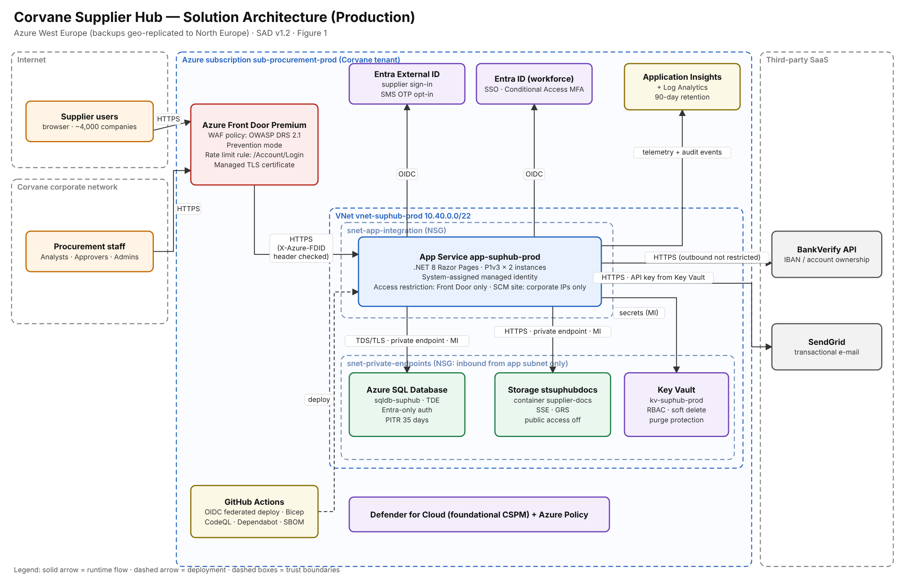

# Corvane Supplier Hub — Solution Architecture Document

| Document control | |
|---|---|
| Application | Corvane Supplier Hub (application ID APP-0731) |
| Organisation | Corvane Logistics B.V. (fictional) — Group Procurement |
| Document version | 1.2 — submitted for Architecture Review Board, 17 Nov 2026 |
| Author | Solution Architect, Procurement Technology |
| Reviewers | Enterprise Security Architecture; Cloud Platform Team; Data Protection Office |
| Status | For ARB approval (target go-live: Q1 2027) |
| Classification of this document | Corvane Confidential |

---pagebreak---

## 1. Purpose and business context

Corvane Supplier Hub is a web portal that replaces the current e-mail and spreadsheet process for onboarding new suppliers. Suppliers register their company, upload compliance documents, and submit bank details for payment. Corvane procurement staff review the submission, validate the bank account, and approve the supplier for use in the ERP.

The application is a single, browser-based line-of-business system hosted on Microsoft Azure. It has no mobile application, exposes no public API to third parties, and does not use any AI or machine-learning capability.

### 1.1 Business functions

1. Supplier self-registration (company profile, contacts, tax identifiers).
2. Upload of compliance documents: certificate of incorporation, tax registration certificate, insurance certificates, signed code of conduct, and a bank confirmation letter.
3. Submission and later change of supplier bank details.
4. Procurement review workflow: an Analyst checks the submission, then an Approver approves or rejects it.
5. Automated bank account ownership check through the BankVerify API.
6. E-mail notifications to suppliers and staff at each workflow step.
7. Export of approved suppliers to the ERP vendor master (manual CSV download by an Approver in phase 1).

### 1.2 Users

| User group | Approx. number | How they sign in |
|---|---|---|
| Supplier users (external) | ~4,000 companies, ~6,500 users | Entra External ID (e-mail + password) |
| Procurement Analysts | 40 | Corvane SSO (Entra ID) |
| Procurement Approvers | 12 | Corvane SSO (Entra ID) |
| Application Admins | 3 | Corvane SSO (Entra ID) |

## 2. Architecture overview

Figure 1 shows the production architecture. All traffic enters through Azure Front Door Premium, which hosts the WAF policy and terminates TLS. Front Door forwards to a single Azure App Service web app that runs the server-rendered .NET 8 Razor Pages application. The App Service reaches its data stores through private endpoints in the application VNet.

## 3. Components and technology stack

| Component | Technology | Notes |
|---|---|---|
| Edge | Azure Front Door Premium | WAF policy, TLS termination with Front Door managed certificate, built-in DDoS protection at the edge |
| Web application | Azure App Service (Linux, P1v3, 2 instances), .NET 8 Razor Pages | Server-rendered UI; jQuery 3.7 and Bootstrap 5 loaded from a public CDN |
| Database | Azure SQL Database (General Purpose, 4 vCore) | Supplier records, workflow state, audit table |
| Document store | Azure Storage account, blob container `supplier-docs` | Uploaded supplier documents |
| Secrets | Azure Key Vault `kv-suphub-prod` | SendGrid API key, BankVerify client certificate |
| Identity (staff) | Microsoft Entra ID | SSO with Conditional Access |
| Identity (suppliers) | Microsoft Entra External ID | Local accounts |
| Monitoring | Application Insights and Log Analytics | 90-day retention |
| CI/CD | GitHub Actions, Bicep infrastructure as code | OIDC federated credential to Azure |
| E-mail | SendGrid (Twilio) | Transactional notifications |
| Bank validation | BankVerify API (third-party SaaS) | IBAN and account-holder name match |

## 4. Data

### 4.1 Data handled and classification

The Data Protection Office has classified the application data as **Corvane Confidential** under the Corvane Information Classification Standard (ICS-02). Each table and blob container is tagged with its classification in the data catalogue.

| Data | Examples | Classification |
|---|---|---|
| Supplier company data | Legal name, registration number, VAT/tax ID, addresses | Confidential |
| Supplier contact personal data | Names, business e-mail, phone numbers | Confidential (personal data under GDPR) |
| Bank details | IBAN, account holder name, bank confirmation letter | Confidential |
| Compliance documents | Certificates, insurance policies | Confidential |
| Workflow and audit data | Status changes, reviewer comments | Internal |

The application does **not** store, process or transmit payment card data. Supplier payments are made by bank transfer from the ERP; PCI DSS is not applicable.

### 4.2 Data stores and protection

- Azure SQL Database uses Transparent Data Encryption (TDE). Azure Storage uses service-side encryption. Both use Microsoft-managed (platform-managed) keys; customer-managed keys were considered and deferred.
- Bank account numbers are shown masked in the UI (only the last four characters are visible to Analysts; Approvers can reveal the full value). In the database the IBAN is held in a normal column protected only by TDE.
- All data is stored in the Azure West Europe region; geo-redundant backups replicate to North Europe. No data leaves the EU.
- Uploaded documents are stored in a private container with public blob access disabled.

## 5. Data flows

1. Supplier browser to Azure Front Door over HTTPS (TLS 1.2 minimum, HTTP redirected to HTTPS).
2. Front Door to App Service over HTTPS. App Service access restrictions allow only the AzureFrontDoor.Backend service tag, and the application checks the `X-Azure-FDID` header against the Corvane Front Door instance.
3. App Service to Entra ID / Entra External ID for OpenID Connect sign-in.
4. App Service to Azure SQL and Azure Storage over private endpoints, authenticated with the App Service system-assigned managed identity (no connection-string passwords).
5. App Service to Key Vault over a private endpoint, using managed identity, to read the SendGrid API key and the BankVerify client certificate at start-up.
6. App Service to BankVerify API (HTTPS, mutual TLS with client certificate) when an Analyst starts bank validation.
7. App Service to SendGrid API (HTTPS, API key) for notifications.
8. App Service to Application Insights for telemetry and audit events.
9. Approver downloads a CSV of approved suppliers and uploads it to the ERP manually.

## 6. Identity, authentication and authorisation

### 6.1 Authentication

- Corvane staff authenticate through Corvane SSO (Microsoft Entra ID, OpenID Connect). A Conditional Access policy requires MFA (Microsoft Authenticator push) for all staff sign-ins to this application.
- Supplier users authenticate with Entra External ID local accounts (e-mail and password, minimum 12 characters). MFA for suppliers is optional: a supplier user can opt in to an SMS one-time passcode. It is not enforced in phase 1.
- Supplier self-service password reset uses an e-mailed verification code. There is no additional account-takeover detection for supplier accounts in phase 1.
- Application session cookies are issued by ASP.NET Core with Secure and HttpOnly flags. The session uses a sliding expiration of 8 hours.

### 6.2 Authorisation

Role-based access control is enforced server-side on every page handler using ASP.NET Core authorisation policies. Roles are assigned through Entra ID app roles:

| Role | Permissions |
|---|---|
| Supplier | Create and edit own company profile; upload documents; view own status |
| Analyst | View all submissions; request changes; start bank validation |
| Approver | Approve or reject; reveal full bank details; export approved suppliers |
| Admin | Manage reference data and e-mail templates; no approval rights |

Supplier users can only access records belonging to their own company; the company ID is taken from the authenticated token, never from the request.

### 6.3 Identity lifecycle

Staff access is granted through the Corvane joiner-mover-leaver process in Entra ID, driven from the HR system. Membership of the Approver and Admin roles is reviewed quarterly by the Head of Procurement Operations. Supplier user accounts that are inactive for 12 months are disabled automatically.

## 7. Business rules and transaction integrity

- **Maker-checker:** an Approver cannot approve a submission they reviewed as Analyst; the application enforces that the approving user differs from the reviewing user.
- Any change to bank details after approval sets the supplier back to "Pending review" and requires a new BankVerify check and a new approval.
- If the BankVerify API is unavailable, the validation request is queued and retried every 15 minutes for 24 hours; the supplier cannot be approved until validation succeeds. The workflow fails closed.
- A Google reCAPTCHA v3 check protects the supplier self-registration form. There are no other anti-automation controls.
- Every new supplier is screened against the EU consolidated sanctions list before approval; a match blocks approval and alerts Compliance.
- Duplicate-supplier detection flags submissions whose tax ID or IBAN matches an existing supplier.

## 8. Hosting, deployment and network

### 8.1 Hosting

The application is hosted entirely on Azure PaaS services in subscription `sub-procurement-prod`, which sits under the Corvane production management group. Azure Policy assigns the Corvane cloud baseline initiative to the management group, and Microsoft Defender for Cloud foundational CSPM reports posture findings to the Cloud Platform Team. Because App Service and Azure SQL are platform services, operating-system and runtime patching is performed by Microsoft.

### 8.2 Network

- The App Service is integrated with VNet `vnet-suphub-prod` (subnet `snet-app-integration`). SQL, Storage and Key Vault are reachable only through private endpoints in `snet-private-endpoints`; their public network access is disabled.
- Network security groups are applied to both subnets. The private endpoint subnet only accepts traffic from the app integration subnet.
- The App Service SCM (Kudu) deployment endpoint is restricted to Corvane corporate IP ranges and the GitHub Actions deployment uses OIDC, so no publishing credentials exist.
- Outbound internet access from the App Service is not restricted. Calls to BankVerify and SendGrid, and any other outbound call, leave through the default App Service outbound addresses without an egress firewall.

### 8.3 Infrastructure as code and deployment

All Azure resources are defined in Bicep and deployed by GitHub Actions. Changes go through pull requests with branch protection (one required reviewer, status checks must pass). In an incident, Platform Engineers may make emergency changes through the Azure portal; these are expected to be back-ported to Bicep afterwards, but no drift detection is in place.

### 8.4 Environments

There are three environments: DEV, UAT and PROD in separate subscriptions. UAT is refreshed monthly from a copy of the production database so that procurement users can test with realistic suppliers.

## 9. Third-party integrations

| Third party | Purpose | Data shared | Assurance status |
|---|---|---|---|
| BankVerify | Bank account ownership check | IBAN, account holder name, supplier legal name | Vendor security assessment completed (VSA-2026-118), DPA signed |
| SendGrid (Twilio) | Transactional e-mail | Contact name, e-mail address, workflow status | Vendor security assessment not yet started; DPA under Twilio standard terms |
| Google reCAPTCHA | Bot check on registration | Browser signals | Accepted under Corvane web standard |

## 10. Security controls

| Area | Control | Status |
|---|---|---|
| Edge protection | Azure Front Door WAF policy with Microsoft Default Rule Set 2.1 and Bot Manager rules, in Prevention mode | In place |
| DDoS | Front Door built-in L3/L4 DDoS protection | In place |
| Rate limiting | WAF custom rule: 20 requests per minute per IP to `/Account/Login`. No rate limits on other pages | Partial |
| CSRF | ASP.NET Core antiforgery tokens validated on all POST handlers (global AutoValidateAntiforgeryToken filter) | In place |
| Input validation | Validation of form fields is done client-side with jQuery Validation. Server-side model validation is implemented on the registration form only; other forms rely on the client-side checks | Partial |
| Output encoding | Razor default HTML encoding | In place |
| File upload | Allowed types PDF, JPG and PNG; maximum 10 MB per file; file names replaced by GUIDs. Malware scanning (Defender for Storage) is planned before go-live but is not yet enabled | Partial |
| Third-party scripts | jQuery and Bootstrap are loaded from a public CDN without Subresource Integrity attributes | Not in place |
| Secrets | All secrets in Key Vault, read with managed identity; no secrets in app settings or source code; Key Vault RBAC, soft delete and purge protection on | In place |
| Encryption in transit | TLS 1.2 minimum at Front Door and App Service, HTTPS only, HSTS not configured | In place |
| Encryption at rest | TDE and Storage SSE with platform-managed keys | In place |
| Service authentication | Managed identity to SQL, Storage and Key Vault; SQL configured for Entra-only authentication | In place |
| Code security | GitHub CodeQL static analysis on every pull request; high-severity findings block merge. No dynamic application security testing (DAST) | Partial |
| Dependencies | Dependabot alerts and security updates; CycloneDX SBOM generated on every build and stored with the release | In place |
| Penetration test | External penetration test by an accredited supplier three weeks before go-live; High and Critical findings must be fixed and retested before go-live | In place |
| Privileged access | The four Platform Engineers hold standing Contributor rights on the production subscription; there is no just-in-time elevation (PIM) for this subscription | Not in place |

## 11. Logging, monitoring, backup and recovery

### 11.1 Logging and monitoring

- The application writes request telemetry, exceptions and dependency calls to Application Insights.
- Business audit events (sign-in, submission, bank detail change, approval, rejection, export) are written to an `AuditEvent` table in Azure SQL and also sent to Application Insights as custom events, with user ID and timestamp. Retention is 90 days in Log Analytics and 7 years in the SQL audit table.
- Logs are not forwarded to the Corvane group SIEM (Microsoft Sentinel). Sentinel integration and correlation rules are planned for phase 2; until then there is no security alerting on application events.
- Availability tests in Application Insights alert the support team when the site is unreachable.

### 11.2 Backup and disaster recovery

- Azure SQL point-in-time restore is retained for 35 days with geo-redundant backup storage; long-term retention keeps monthly backups for 12 months.
- The document storage account uses geo-redundant storage (GRS) with blob soft delete (14 days) and versioning.
- Target RTO is 24 hours and RPO is 1 hour. A restore of the database or storage account has not yet been tested; a DR test is planned within six months of go-live.

## 12. Open items and decisions requested from the ARB

| ID | Item | Owner | Target |
|---|---|---|---|
| OI-1 | Enable Defender for Storage malware scanning on `supplier-docs` | Cloud Platform | Before go-live |
| OI-2 | Forward logs to Sentinel and build correlation rules | SOC | Phase 2 (Q3 2027) |
| OI-3 | Vendor security assessment for SendGrid | Third-Party Risk | Before go-live |
| OI-4 | Enforce MFA for supplier users | Procurement Tech | Phase 2 |
| OI-5 | Customer-managed keys for SQL and Storage | Cloud Platform | Deferred, risk accepted by Head of Procurement |
| OI-6 | Server-side validation for all forms | Procurement Tech | Before go-live |
| OI-7 | Restore test of SQL and storage backups | Cloud Platform | Within 6 months of go-live |
