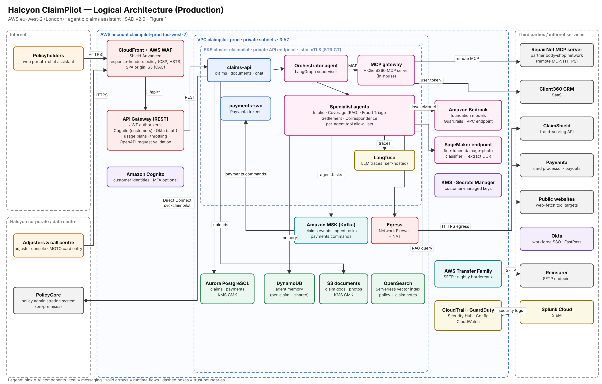
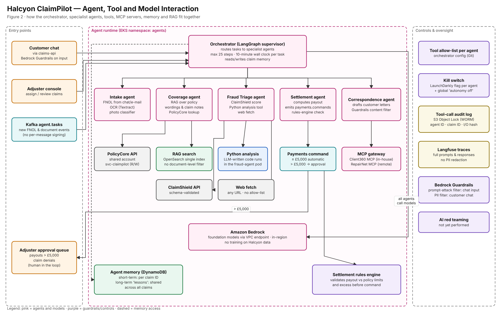
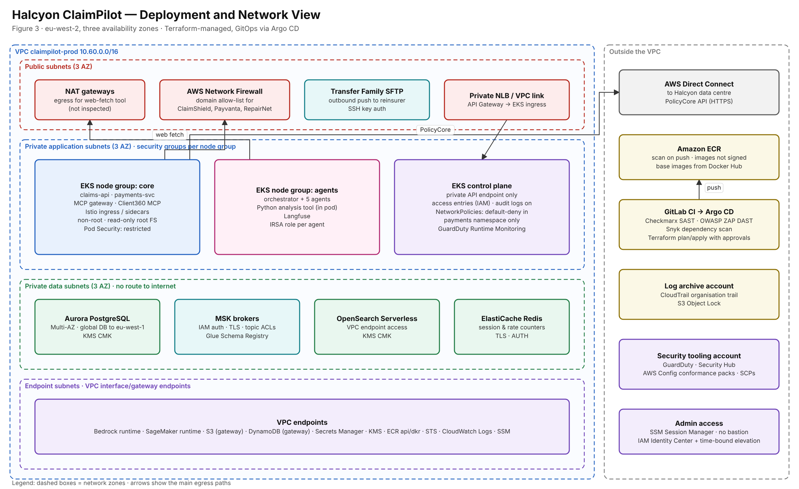

# Halcyon ClaimPilot — Solution Architecture Document

| Document control | |
|---|---|
| Application | ClaimPilot — agentic claims assistant (application ID HM-APP-2214) |
| Organisation | Halcyon Mutual Insurance plc (fictional) — Claims Transformation |
| Document version | 2.0 — submitted to the Architecture Review Board and AI Steering Committee, 17 Nov 2026 |
| Author | Lead Solution Architect, Claims Platforms |
| Contributors | AI Engineering; Cloud Platform Engineering; Payments; Information Security; Data Protection Office |
| Status | For ARB approval (pilot go-live: March 2027, motor and home claims) |
| Classification of this document | Halcyon Restricted |

---pagebreak---

## 1. Purpose and business context

ClaimPilot automates the handling of motor and home insurance claims for Halcyon Mutual's 1.8 million retail policyholders. Policyholders report a claim (first notification of loss, FNOL) through the web portal or the chat assistant, upload photos and documents, and receive progress updates and decision letters. A team of AI agents gathers the facts, checks policy coverage, triages fraud risk, calculates the settlement and drafts customer correspondence. Claims adjusters supervise the agents through an adjuster console, approve high-value payouts and all claim denials, and handle complex cases.

The business case is to cut average claim cycle time from 11 days to 3 days for simple claims and to let adjusters focus on complex and vulnerable-customer cases.

### 1.1 Business functions

1. FNOL intake through the web portal, the chat assistant, or an adjuster taking a phone call.
2. Upload and processing of claim evidence: photos of damage, repair estimates, police reports, medical letters for injury claims.
3. Coverage determination against the customer's policy wording and endorsements.
4. Fraud triage using the ClaimShield score, internal claims history and open-source checks.
5. Settlement calculation and payout by bank transfer or refund to card.
6. Collection of the policy excess by card, taken in the portal or keyed by call-centre staff (MOTO) during a phone call.
7. Generation of customer letters and messages (acknowledgement, requests for information, decision letters).
8. Repair booking with partner body shops through the RepairNet network.
9. Nightly claims bordereaux to the reinsurer.

### 1.2 Users

| User group | Approx. number | Access channel | Authentication |
|---|---|---|---|
| Policyholders / claimants | 1.8 million eligible; ~30,000 claims a month | Web portal and chat assistant | Amazon Cognito (e-mail + password, optional MFA) |
| Claims adjusters | 420 | Adjuster console | Okta SSO |
| Call-centre agents | 300 | Adjuster console (restricted view) | Okta SSO |
| Claims team leaders | 45 | Adjuster console + approval queue | Okta SSO |
| AI Engineering / platform support | 25 | AWS console, Argo CD, Langfuse | Okta SSO + IAM Identity Center |

## 2. Architecture overview

Figure 1 shows the logical architecture. The customer portal and adjuster console are single-page applications served from CloudFront. All API calls go through Amazon API Gateway to microservices running on Amazon EKS. The agent runtime (an orchestrator agent and five specialist agents) runs in the same EKS cluster and uses foundation models on Amazon Bedrock. Asynchronous work flows over Amazon MSK (Kafka). Claim data is held in Aurora PostgreSQL, documents in S3, agent memory in DynamoDB, and the RAG index in OpenSearch Serverless.

## 3. Components and technology stack

| Component | Technology | Purpose |
|---|---|---|
| Web front ends | React 18 SPAs on S3 + CloudFront | Customer portal, chat UI, adjuster console |
| Edge | CloudFront, AWS WAF, AWS Shield Advanced | TLS termination, WAF, DDoS protection |
| API layer | Amazon API Gateway (REST) with JWT authorizers | Public and staff APIs |
| Customer identity | Amazon Cognito user pool | Policyholder accounts |
| Workforce identity | Okta | SSO for staff |
| Container platform | Amazon EKS 1.31, Istio 1.23 service mesh | All microservices and agents |
| Microservices | claims-api, payments-svc (Java 21 / Spring Boot) | Claim lifecycle, payments |
| Agent runtime | Python 3.12, LangGraph, orchestrator + 5 specialist agents | Claim automation |
| Foundation models | Amazon Bedrock (Anthropic and Amazon models), invoked in eu-west-2 | Reasoning, extraction, drafting |
| Custom model | Damage-photo classifier fine-tuned on SageMaker, served from a SageMaker endpoint | Estimate damage severity from photos |
| OCR | Amazon Textract | Read uploaded documents |
| RAG store | Amazon OpenSearch Serverless (vector collection) | Policy wordings and claim notes |
| Agent memory | Amazon DynamoDB | Conversation and task state |
| Databases | Aurora PostgreSQL 16 | Claims, payments, audit |
| Object storage | Amazon S3 | Documents, photos, model artefacts |
| Messaging | Amazon MSK (Kafka 3.7) with AWS Glue Schema Registry | Events and agent tasks |
| Batch file transfer | AWS Transfer Family (SFTP) | Bordereaux to reinsurer |
| MCP | In-house MCP gateway; Client360 MCP server (in-house); RepairNet MCP server (partner, remote) | Tool access to CRM and repair network |
| LLM observability | Langfuse (self-hosted on EKS) | Prompt / response traces and evaluations |
| Feature flags | LaunchDarkly | Agent kill switches |
| CI/CD | GitLab CI, Argo CD (GitOps), Terraform | Build and deploy |
| SIEM | Splunk Cloud | Security monitoring |

## 4. AI, agents, tools and MCP

### 4.1 Agent design

Figure 2 shows how the agents interact. The **orchestrator** (a LangGraph supervisor) receives tasks from the chat channel, the adjuster console and the Kafka topic `agent.tasks`, and routes them to five **specialist agents**:

| Agent | Responsibilities | Tools it may call |
|---|---|---|
| Intake | Builds the FNOL record from chat, e-mail and uploads; extracts data from documents; classifies damage photos | Textract OCR, damage-photo classifier, claims-api |
| Coverage | Determines whether the loss is covered and which limits and excess apply | RAG search, PolicyCore API |
| Fraud Triage | Scores fraud risk and gathers supporting facts | ClaimShield API, Python analysis tool, web fetch, claims history |
| Settlement | Calculates the payout and issues payment commands | Payments command, PolicyCore API |
| Correspondence | Drafts customer letters and chat replies | Letter templates, Client360 MCP, RepairNet MCP |

Each agent may only call the tools on its allow-list, which is defined in the orchestrator configuration in Git and enforced by the orchestrator at run time. Tool schemas are defined as Pydantic models with typed, constrained parameters (enumerations, ranges and regular-expression patterns); calls with invalid parameters are rejected before execution.

### 4.2 Autonomy, human oversight and limits

- The Settlement agent may issue payouts of **up to £5,000 autonomously**. Payouts above £5,000 and every claim denial are placed in the adjuster approval queue and need a claims adjuster's approval before anything is sent or paid.
- Before a payment command is published, the settlement rules engine checks the amount against the policy limits, the excess and the claim reserve. Outputs of the other agents that trigger tool calls are not validated by a separate rules layer.
- Each task is bounded: at most 25 agent steps and a 10-minute wall-clock limit, after which the task is handed to an adjuster.
- **Kill switch:** each agent has a LaunchDarkly flag, and a global "autonomy off" flag routes all new and in-flight claims to the manual adjuster queue within 60 seconds.
- Agents call PolicyCore with a single shared service account, `svc-claimpilot`, which has read and write access to all policies. The calling user's identity is not propagated to PolicyCore.
- Each agent runs under its own Kubernetes service account and IAM role (IRSA), apart from the shared PolicyCore account above.
- Synchronous calls between agents go through the Istio mesh with mutual TLS. Asynchronous hand-offs over `agent.tasks` carry no per-message agent identity or signature; any service with produce rights on the topic can create agent tasks.

### 4.3 Models and model endpoints

- All foundation-model calls go to **Amazon Bedrock in eu-west-2** through a VPC interface endpoint. Under the Bedrock service terms, prompts and completions are not stored by the model providers or used to train models. Cross-region inference is disabled.
- Model, prompt and agent-graph versions are recorded in Git; system prompts are versioned and released through the normal pipeline. The Bedrock Guardrails configuration is currently changed in the AWS console by the AI Engineering team, outside the pipeline.
- The **damage-photo classifier** is a vision model fine-tuned by Halcyon on 410,000 historical claim photos (2019–2025). The training dataset was approved by the Data Governance Council (DGC-2026-07). The photos were not scrubbed of faces, vehicle registration plates or house numbers before training. Model artefacts are stored in S3 and deployed to SageMaker; artefacts are not signed or hash-verified at deployment.
- Bedrock base models are taken only from the AWS-managed model catalogue.
- Bedrock usage is limited by the account's service quotas. There is no per-user, per-claim or per-day token or spend budget.

### 4.4 Guardrails and output handling

- **Bedrock Guardrails** are applied to the customer chat channel: the prompt-attack filter on customer input, and the PII filter and denied-topics policy on chat responses. Guardrails are not applied to text extracted from uploaded documents, to RAG results, or to tool outputs, and the PII filter is not applied to responses shown in the adjuster console.
- The Correspondence agent's letters pass through Guardrails content filters (hate, insults, sexual, violence, misconduct) and must fit an approved letter template.
- Customers are told in the chat window and in every letter that ClaimPilot uses AI and that they can ask for a human adjuster. Coverage decisions quote the policy clause and the document they rely on.
- Content returned by the web fetch tool and by the RepairNet MCP server is passed to the agents as-is. ClaimShield and PolicyCore responses are validated against their JSON schemas.
- The Fraud Triage agent has a **Python analysis tool** that executes model-generated Python code inside the fraud-agent pod to analyse claim history.
- The **web fetch tool** retrieves any URL the agent supplies, for example a repair quote link or social-media post supplied by the customer. No URL allow-list or private-address block is applied.

### 4.5 Retrieval-augmented generation (RAG)

- The RAG corpus has two sources: (1) policy wordings and endorsements from the SharePoint "Published" library, which only the Product team can publish to; and (2) adjuster and customer claim notes, which are ingested automatically every hour, including free text written by customers.
- All agents query a single OpenSearch vector index that holds both sources. No document-level security filter is applied, so a query can return notes from any customer's claim.
- An ingestion Lambda chunks and embeds documents with Amazon Titan embeddings.

### 4.6 Agent memory

- Short-term memory (conversation and task state) is stored in DynamoDB, partitioned by claim ID and deleted 90 days after the claim closes.
- A long-term "lessons learned" memory, written by the orchestrator after each claim, is shared across all claims and all customers. It has no defined retention period.

### 4.7 MCP servers

- An in-house **MCP gateway** fronts all MCP traffic and logs every MCP request and response (tool name, arguments, result size, caller agent, claim ID) to the audit log.
- The **Client360 MCP server** is built in-house and exposes CRM tools (look up customer, add contact note). The adjuster's Okta access token is forwarded by the gateway to the Client360 MCP server, which passes it through unchanged to the Client360 SaaS API.
- The **RepairNet MCP server** is operated by the partner and reached over HTTPS. It was connected during the pilot without a provenance or security review; the third-party assessment is in progress. Its credentials (a static API key) are stored as a Kubernetes Secret until migration to Secrets Manager.
- The gateway fetches each server's tool list and tool descriptions dynamically at start-up; tool definitions are not pinned or compared with previous versions.

### 4.8 AI governance

ClaimPilot is registered in the Halcyon AI model register (entry AI-REG-0042). The AI Steering Committee approved the use case on 3 Sep 2026 and classified it as high-risk under the Halcyon AI Policy because it affects customers' financial outcomes. Accuracy is evaluated offline against 5,000 labelled historical claims before each release. No adversarial testing or AI red-team exercise has been performed yet; one is planned for Q2 2027, after go-live.

## 5. Data

### 5.1 Classification

The Data Protection Office classified ClaimPilot data as **Halcyon Restricted**, the highest level, because it contains special-category health data (injury claims), financial data and payment card data. Classification labels are applied as AWS resource tags and as metadata on S3 objects.

| Data | Examples | Classification |
|---|---|---|
| Policyholder personal data | Name, address, date of birth, contact details | Restricted |
| Claim data | Loss description, photos, repair estimates, police reports | Restricted |
| Special-category data | Injury and medical letters | Restricted |
| Financial data | Bank account details for payouts | Restricted |
| Payment card data | PAN keyed by call-centre staff (MOTO), card tokens | Restricted, PCI DSS scope |

### 5.2 Payment card data (PCI DSS)

ClaimPilot **is in PCI DSS scope**. Customers paying an excess online enter card details in Payvanta hosted fields, so PAN does not touch ClaimPilot on that path. However, call-centre agents can key a customer's card number into the adjuster console during a phone call (MOTO). The PAN passes through API Gateway and claims-api to payments-svc, which exchanges it for a Payvanta token. Only the token and last four digits are stored. payments-svc runs in its own Kubernetes namespace with a default-deny NetworkPolicy.

### 5.3 Data stores and protection

- Aurora, S3, DynamoDB, OpenSearch Serverless and MSK are encrypted at rest with AWS KMS customer-managed keys, one key per data domain, with annual automatic rotation.
- Payout bank account numbers are encrypted at field level in Aurora with a dedicated KMS key. Injury and medical details are stored in claim notes as clear text (protected only by storage encryption) and are ingested into the RAG index.
- Claims records are retained for 7 years after closure under the Halcyon records schedule, then deleted. S3 lifecycle rules delete documents at the same point.
- All production data stays in eu-west-2 (London), with Aurora global database replication to eu-west-1 (Ireland) for disaster recovery. Bedrock processing stays in eu-west-2.
- A Data Protection Impact Assessment (DPIA-2026-031) has been completed. The process for handling data subject access and erasure requests does not yet cover agent memory, Langfuse traces or the RAG index.
- Test environments use synthetic data, except the model-evaluation environment, which holds a 5% sample of production claims for accuracy testing.

## 6. Data flows

1. Customer or adjuster browser to CloudFront (HTTPS, TLS 1.2+); CloudFront serves the SPA from S3 through origin access control.
2. Browser to API Gateway with a Cognito (customer) or Okta (staff) JWT; API Gateway validates the token and the request against the OpenAPI schema.
3. API Gateway to claims-api through a private VPC link and an internal Network Load Balancer, then through the Istio ingress gateway (mTLS inside the mesh).
4. claims-api writes the claim to Aurora and the documents to S3, then publishes `claims.events`.
5. The orchestrator consumes `agent.tasks`, calls specialist agents, which call Bedrock, SageMaker, Textract, OpenSearch and tools.
6. Agents call PolicyCore in the Halcyon data centre over AWS Direct Connect (HTTPS) with the `svc-claimpilot` account.
7. Agents call ClaimShield, Payvanta and RepairNet through AWS Network Firewall, which allows only their domains. The web fetch tool leaves through a NAT gateway path that is not filtered.
8. The Settlement agent publishes to `payments.commands`; payments-svc consumes the command and calls Payvanta to pay out or refund.
9. Payvanta sends payment status webhooks to API Gateway.
10. Each night, a batch job writes the bordereaux CSV to S3 and AWS Transfer Family pushes it to the reinsurer's SFTP server.
11. Logs flow to CloudWatch and Splunk; LLM traces flow to Langfuse.

## 7. Identity, authentication and authorisation

### 7.1 Authentication

- Staff sign in through Okta SSO (OIDC). Okta FastPass (phishing-resistant, device-bound) is mandatory for all staff.
- Customers sign in through Cognito with e-mail and password. MFA (TOTP or SMS) is optional for customers. Cognito advanced security (adaptive authentication and compromised-credential detection) is enabled in audit-only mode; it does not block risky sign-ins yet.
- Access tokens live for 15 minutes; refresh tokens rotate on use and are revoked at sign-out. Tokens are held in memory by the SPA and sent as bearer tokens, not cookies.
- Staff accounts are created and removed automatically from Workday through Okta lifecycle management. Adjuster and team-leader roles are recertified quarterly.

### 7.2 Authorisation

- API Gateway JWT authorizers check issuer, audience, expiry and signature for every request. Scopes separate customer, adjuster and team-leader functions; payout approval and refund endpoints require the team-leader or adjuster scope.
- claims-api checks that a customer can only read or change claims on their own policies.
- Any adjuster can open any claim in their region; claim access is not restricted to the assigned adjuster.
- The customer chat assistant is scoped to the signed-in customer's claims: the claim IDs available to the agent are taken from the session, not from the conversation.

### 7.3 Privileged and administrative access

- Administrative access to AWS uses IAM Identity Center with time-bound elevation approved in ServiceNow; there are no standing administrator roles.
- Node access is through SSM Session Manager only; there is no bastion host and SSH is disabled.
- The EKS API endpoint is private; cluster access uses EKS access entries mapped to IAM roles.

## 8. Hosting, deployment and network

Figure 3 shows the deployment and network view.

### 8.1 Cloud foundation

- The workload runs in a dedicated AWS account in the Halcyon AWS Organization. Service control policies prevent disabling CloudTrail, GuardDuty and Config, and restrict regions to eu-west-2 and eu-west-1.
- AWS Security Hub and AWS Config conformance packs (CIS AWS Foundations 3.0) report to the security tooling account. CloudTrail is an organisation trail stored in the log archive account with S3 Object Lock.
- IAM roles are per service (IRSA) with permission boundaries; no IAM users or long-lived access keys exist in the account.
- All infrastructure is defined in Terraform and deployed through GitLab CI with a manual approval for production. Kubernetes workloads are deployed by Argo CD from Git, which detects and reverts drift. Console write access to production is blocked by SCP apart from break-glass.

### 8.2 Network

- Three-tier VPC across three availability zones: public subnets (NAT gateways, Network Firewall endpoints, Transfer Family), private application subnets (EKS nodes) and private data subnets with no internet route (Aurora, MSK, ElastiCache).
- Security groups are defined per node group and per data service and allow only the required ports from named security groups.
- VPC endpoints are used for Bedrock, SageMaker, S3, DynamoDB, Secrets Manager, KMS, ECR, STS, CloudWatch Logs and SSM, so AWS service traffic does not cross the internet.
- Outbound internet traffic from the cluster passes AWS Network Firewall with a domain allow-list (ClaimShield, Payvanta, RepairNet, Okta). The web fetch tool is the exception: it uses a separate NAT path that is not inspected so it can reach arbitrary websites.
- Istio runs with mTLS in STRICT mode for all service-to-service traffic. Kubernetes NetworkPolicies (default deny) are applied in the payments namespace only; other namespaces rely on Istio authorisation policies, which are not yet written for the agents namespace.

### 8.3 Containers

- Images are built in GitLab CI and stored in Amazon ECR with scan-on-push. Images are not signed, and the base images are pulled from public Docker Hub.
- Pods run as non-root with a read-only root file system, dropped Linux capabilities and the RuntimeDefault seccomp profile. The Kubernetes Pod Security Standard "restricted" is enforced in all application namespaces.
- GuardDuty EKS Runtime Monitoring is enabled on all nodes.

## 9. APIs and integrations

### 9.1 API management

- The external API is described by OpenAPI 3.1 specifications kept in Git and published in the Halcyon API catalogue. The internal agent APIs and MCP tools are not in the API catalogue.
- API Gateway usage plans set per-client rate and burst limits; request payloads are limited to 10 MB; list endpoints are paginated with a maximum page size of 100.
- AWS WAF rate-based rules limit requests per IP at the edge.
- CORS on API Gateway allows only the portal and console origins.
- Payvanta webhooks are verified with an HMAC-SHA256 signature and a 5-minute timestamp window; unsigned or stale webhooks are rejected.

### 9.2 Third parties

| Third party | Purpose | Data shared | Assurance |
|---|---|---|---|
| Payvanta | Card processing, payouts | PAN (MOTO), tokens, bank details | PCI DSS AoC on file; TPRM assessment complete |
| ClaimShield | Fraud scoring | Claim summary, policy data | TPRM assessment complete; DPA signed |
| RepairNet | Repair booking via remote MCP | Vehicle, damage, customer contact | TPRM assessment in progress |
| Client360 | CRM | Customer profile, contact notes | TPRM assessment complete |
| Reinsurer | Bordereaux | Claim-level financials, policy IDs | Contractual; annual review |

## 10. Messaging and batch

- **Amazon MSK** clusters use IAM authentication; each service has its own IAM role with topic-level ACLs (produce or consume rights only on the topics it needs).
- All traffic to MSK uses TLS and data is encrypted at rest. Messages are not signed. `agent.tasks` messages carry the full claim record, including personal and medical data.
- All topics use Avro schemas registered in the AWS Glue Schema Registry with BACKWARD compatibility; producers and consumers validate against the registry.
- `payments.commands` messages carry an idempotency key, and payments-svc rejects duplicates. `agent.tasks` has no de-duplication; a redelivered message can start a second run of the same task.
- **Bordereaux:** the nightly CSV is pushed by AWS Transfer Family over SFTP with SSH key authentication. The file is not encrypted or signed at file level and no checksum is sent with it.

## 11. Security controls summary

| Area | Control | Status |
|---|---|---|
| Edge | AWS WAF (AWS managed core, known-bad-inputs and SQLi rule groups) and Shield Advanced on CloudFront and API Gateway | In place |
| Headers | CloudFront response-headers policy sets CSP, HSTS, X-Content-Type-Options and Referrer-Policy | In place |
| Sessions | 15-minute access tokens, rotating refresh tokens, revocation at sign-out | In place |
| Input validation | OpenAPI request validation at API Gateway and Bean Validation in the services | In place |
| Transport encryption | TLS 1.2+ everywhere; ACM-managed certificates with automatic renewal; TLS policy per Halcyon Cryptography Standard CS-04 | In place |
| Secrets | AWS Secrets Manager with automatic rotation for database and API credentials, read through IRSA; exception: RepairNet API key in a Kubernetes Secret | Partial |
| SAST / DAST | Checkmarx SAST and OWASP ZAP DAST in the GitLab pipeline; critical findings block release | In place |
| Dependencies | Snyk dependency scanning on every build. No SBOM is produced | Partial |
| Vulnerability management | Patch SLAs: critical 7 days, high 30 days; EKS node AMIs rebuilt weekly | In place |
| Penetration test | External penetration test of the web portal, console and APIs before go-live. The agent and AI components are out of scope of the test | Partial |
| Business logic | Idempotency keys on payments; payouts checked by the settlement rules engine | In place |
| Abuse | Fraud Triage agent scores every claim. There are no limits on the number of claims per policy or per payee bank account in a period | Partial |
| File uploads | Uploads to S3 by pre-signed URL, max 20 MB, image/PDF types only. GuardDuty Malware Protection for S3 scans each object asynchronously; agents may read a document before the scan verdict is available | Partial |
| Supply chain | GitLab CI with protected branches, two-person review, Terraform plan approval | In place |

## 12. Logging, monitoring, backup and recovery

### 12.1 Logging and audit

- Application and access logs go to CloudWatch Logs and are forwarded to Splunk Cloud. CloudTrail, GuardDuty and Security Hub findings are also forwarded to Splunk.
- Every request carries an OpenTelemetry trace ID that is propagated through API Gateway, services, Kafka headers and agent runs, so Splunk correlation searches can follow a claim end to end. The SOC has correlation rules for authentication anomalies and payment fraud patterns.
- **Agent audit trail:** every tool call is recorded with agent ID, claim ID, tool name, a hash of inputs and outputs, and the decision reason, in an S3 bucket with Object Lock (compliance mode, 7 years).
- **Langfuse** captures full prompts, completions and tool traces for every agent run, linked to claim ID, for debugging and evaluation. Traces include claimant personal and medical data; no redaction is applied before traces are stored. Langfuse traces are not forwarded to Splunk.

### 12.2 Monitoring

- CloudWatch alarms cover error rates, latency, Kafka consumer lag and Bedrock throttling.
- There are no alerts on AI-specific signals such as spikes in Guardrails blocks, unusual tool-call patterns or payout volumes.
- If Bedrock is throttled or unavailable, the orchestrator places claims in the manual adjuster queue; no claim is decided without a model response.

### 12.3 Incident response

The Halcyon cloud incident runbooks cover the platform (account compromise, data exposure, ransomware). An AI-specific playbook (for example a prompt-injection campaign or a misbehaving agent) has not been written yet; the kill switch in section 4.2 is the main containment measure.

### 12.4 Backup and disaster recovery

- Aurora: continuous backup (35-day point-in-time restore) and a global database in eu-west-1. DynamoDB point-in-time recovery. S3 versioning with cross-region replication.
- RTO 4 hours, RPO 15 minutes. A full regional fail-over test was completed in October 2026, and restore tests run quarterly.

## 13. Risks and open items

| ID | Item | Owner | Target |
|---|---|---|---|
| R-1 | Document-level access control for the RAG index | AI Engineering | Before go-live |
| R-2 | Replace token passthrough to Client360 with scoped credentials | AI Engineering | Before go-live |
| R-3 | Complete RepairNet third-party assessment; move its API key to Secrets Manager | TPRM / Platform | Before go-live |
| R-4 | Redact PII from Langfuse traces | AI Engineering | Q1 2027 |
| R-5 | AI red-team exercise | Information Security | Q2 2027 |
| R-6 | Sandbox the Python analysis tool; URL allow-list for web fetch | AI Engineering | Q1 2027 |
| R-7 | Sign container images and stop using public base images | Platform | Q2 2027 |
| R-8 | Per-claim token and spend budgets for agents | AI Engineering | Q2 2027 |
