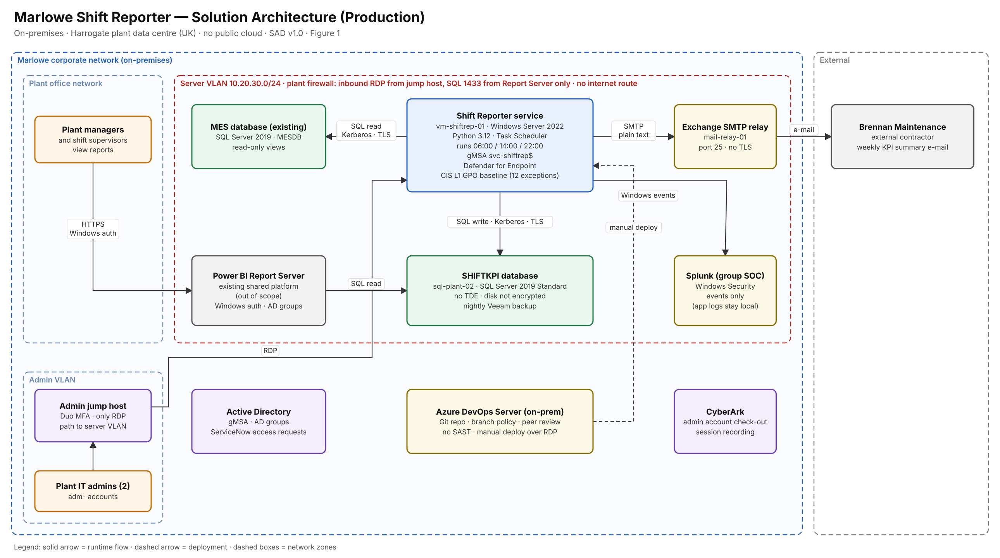

# Marlowe Shift Reporter — Solution Architecture Document

| Document control | |
|---|---|
| Application | Marlowe Shift Reporter (application ID MF-APP-0214) |
| Organisation | Marlowe Foods Ltd (fictional) — Harrogate production plant |
| Document version | 1.0 — submitted for Architecture Review Board, 21 Nov 2026 |
| Author | Plant Systems Lead, Manufacturing IT |
| Reviewers | Group Security Architecture; Infrastructure Services |
| Status | For ARB approval (target go-live: January 2027) |
| Classification of this document | Marlowe Internal |

---pagebreak---

## 1. Purpose and business context

Marlowe Shift Reporter is a small scheduled service that calculates production key performance indicators (KPIs) at the end of every shift at the Harrogate plant. Today shift supervisors copy figures from the Manufacturing Execution System (MES) into a spreadsheet by hand. The new service reads the production counts directly from the MES database, calculates the shift KPIs (output, scrap rate, line availability and overall equipment effectiveness) and stores the results in a reporting database.

The application has **no user interface of its own** and exposes **no API**. Plant managers see the results through the existing Power BI Report Server, which is a separate shared platform with its own architecture approval and is out of scope for this document. The service does not exchange files with any system and uses no message queue, event bus or file transfer. It does not use any AI or machine-learning capability.

### 1.1 Business functions

1. Run automatically at the end of each shift (06:00, 14:00 and 22:00).
2. Read production counts, scrap counts and line stoppage records for the shift from the MES database.
3. Calculate shift KPIs and write them to the SHIFTKPI reporting database.
4. Send a short shift summary e-mail to the plant management distribution list.
5. Once a week, send a KPI summary e-mail to Brennan Maintenance Services, the external maintenance contractor, so they can plan preventive maintenance.

### 1.2 Users

| User group | Approx. number | How they use the application |
|---|---|---|
| Plant managers and shift supervisors | 25 | Read KPI reports in Power BI Report Server (Windows sign-in) |
| Plant IT administrators | 2 | Administer the server and the service |
| Brennan Maintenance planners (external) | 3 | Receive the weekly summary e-mail only; no system access |

## 2. Architecture overview

Figure 1 shows the production architecture. Everything runs on premises in the Harrogate plant data centre on VMware virtual machines. There is no public cloud component. The service runs on one Windows Server virtual machine in the plant server VLAN and talks to two SQL Server databases and the internal Exchange mail relay.

## 3. Components and technology stack

| Component | Technology | Notes |
|---|---|---|
| Shift Reporter service | Python 3.12 scripts on `vm-shiftrep-01`, Windows Server 2022, run by Windows Task Scheduler | Runs under the group managed service account `svc-shiftrep$` |
| Source database | MES database `MESDB`, SQL Server 2019 (existing) | Read through three read-only views |
| Reporting database | `SHIFTKPI` on `sql-plant-02`, SQL Server 2019 Standard edition | New database for this application |
| Report viewing | Power BI Report Server (existing shared platform) | Out of scope |
| E-mail | Exchange Server 2019 SMTP relay `mail-relay-01` | Internal relay |
| Identity | Active Directory (Marlowe forest) | gMSA, AD security groups |
| Source control | Azure DevOps Server 2022 (on premises) | Git repository and branch policy |
| Endpoint protection | Microsoft Defender for Endpoint | On both servers |

Python libraries used: pyodbc, pandas and Jinja2 (for the e-mail template), pinned in `requirements.txt`.

## 4. Data

### 4.1 Data handled and classification

The application data is classified **Marlowe Internal** under the Marlowe Information Classification Policy (ISP-04). It contains production figures and the names of the shift supervisors on duty; it contains no customer data, no financial account data and no payment card data. PCI DSS is not applicable.

| Data | Examples | Classification |
|---|---|---|
| Production counts | Units produced per line, scrap counts, stoppage minutes | Internal |
| Shift KPIs | Output, scrap rate, availability, OEE | Internal |
| Supervisor names | Name of the supervisor on each shift | Internal (personal data) |

### 4.2 Data stores and protection

- The SHIFTKPI database runs on SQL Server 2019 Standard edition. Transparent Data Encryption is not enabled, and the virtual machine disks of `sql-plant-02` and `vm-shiftrep-01` are not encrypted with BitLocker. Infrastructure Services consider the physical security of the plant data centre sufficient.
- KPI records are kept for three years. A monthly SQL Agent job deletes records older than three years.
- All data stays in the Harrogate plant data centre in the United Kingdom.
- The test environment uses a synthetic MES dataset generated by the Plant Systems team; no production data is copied to test.

## 5. Data flows

1. Task Scheduler starts the service at the end of each shift.
2. The service reads the MES views over SQL Server's TDS protocol with Windows integrated (Kerberos) authentication as `svc-shiftrep$`. The connection is encrypted with TLS 1.2 (`Encrypt=yes`). The SQL Server TLS certificates are issued by the Marlowe internal certificate authority.
3. The service writes the calculated KPIs to SHIFTKPI, again with Kerberos authentication and TLS 1.2.
4. The service sends the shift summary to `mail-relay-01` over SMTP on port 25. The relay accepts unauthenticated mail from the server VLAN and the connection is not encrypted (no STARTTLS).
5. Weekly, the relay forwards the KPI summary e-mail to Brennan Maintenance over the internet.
6. Power BI Report Server reads SHIFTKPI with its own service account (out of scope).

## 6. Identity, authentication and authorisation

### 6.1 Users and administrators

- Plant managers and supervisors sign in to Power BI Report Server with their Marlowe Active Directory account (Windows integrated sign-in). Access to the Shift KPI reports is granted through the AD group `GG-ShiftKPI-Readers`. They do not use MFA because the reports are only reachable from the plant office network.
- The two Plant IT administrators use separate `adm-` accounts. Those accounts are checked out through CyberArk with session recording. Administrative access to the servers is only possible over RDP from the admin jump host, which requires Duo MFA.

### 6.2 Service identity and permissions

- The service runs as the group managed service account `svc-shiftrep$`. Active Directory rotates its password automatically; no password or connection string secret is stored on the server or in the code.
- On MESDB the account can only `SELECT` from three read-only views.
- On SHIFTKPI the account is a member of `db_owner` because the deployment script creates tables; this is more than the service needs at run time.

### 6.3 Identity lifecycle

Access to `GG-ShiftKPI-Readers` and the admin groups is requested through ServiceNow and approved by the Plant Manager. Group membership is recertified quarterly. Leavers are removed by the standard HR-driven Active Directory leaver process.

## 7. Business rules and data integrity

- Every row read from the MES is range-checked (no negative counts, stoppage minutes not longer than the shift). Rows that fail the check are skipped and written to the service log. All database statements use parameterised queries.
- **Reconciliation check:** the calculated shift output is compared with the goods-receipt total that the ERP posts for the same shift. If they differ by more than 2%, the KPI record is flagged "unverified" and the flag is shown on the report.
- If the MES database is unavailable, the service retries three times at 10-minute intervals and then e-mails Plant IT. The Power BI report then still shows the previous shift's figures, with no indication that they are out of date.

## 8. Hosting, deployment and network

### 8.1 Hosting

Both virtual machines run on the plant VMware cluster in the Harrogate data centre. They are joined to the Marlowe domain and receive the Marlowe server Group Policy baseline, which is based on the CIS Windows Server 2022 Level 1 benchmark; 12 settings have documented exceptions for plant applications. SQL Server itself has not been hardened beyond the default installation. Both servers were built by hand from the standard VMware template, and configuration changes are made manually over RDP; there is no configuration management tool and no drift detection. Microsoft Defender for Endpoint is installed on both servers and reports to the group SOC.

### 8.2 Network

- Both servers are in the server VLAN 10.20.30.0/24 behind the plant firewall. The firewall allows inbound RDP only from the admin jump host and inbound SQL (1433) to `sql-plant-02` only from the Power BI Report Server and `vm-shiftrep-01`.
- The server VLAN has no route to the internet; outbound traffic is denied by default at the plant firewall. The only external flow is the e-mail that the Exchange relay forwards.

### 8.3 Patching and vulnerability management

Windows and SQL Server updates are deployed monthly through WSUS; critical security updates are installed within 14 days. Qualys scans the server VLAN weekly and findings are tracked in ServiceNow.

### 8.4 Build and deployment

The code is stored in Azure DevOps Server with a branch policy that requires one peer reviewer. There is no automated pipeline: a Plant IT administrator copies the released scripts to the server over RDP and updates the scheduled task. No static analysis (SAST) tool is used, and Python dependencies are not scanned for known vulnerabilities.

## 9. Third-party integrations

| Third party | Purpose | Data shared | Assurance status |
|---|---|---|---|
| Brennan Maintenance Services | Preventive maintenance planning | Weekly line KPIs and stoppage minutes (no supervisor names) | Maintenance contract with confidentiality clause; no vendor security assessment performed |

## 10. Security controls

| Area | Control | Status |
|---|---|---|
| Network | Plant firewall rules as in §8.2; no internet route from the server VLAN | In place |
| Host hardening | CIS Level 1 GPO baseline with 12 exceptions; SQL Server default installation | Partial |
| Endpoint protection | Microsoft Defender for Endpoint on both servers | In place |
| Service authentication | gMSA with Kerberos to both databases; no stored secrets | In place |
| Encryption in transit | TLS 1.2 on SQL connections; SMTP to the relay is unencrypted | Partial |
| Encryption at rest | No TDE, no disk encryption | Not in place |
| Privileged access | CyberArk check-out and session recording; RDP only via MFA jump host | In place |
| Code security | Peer review only; no SAST, no dependency scanning | Partial |
| Penetration test | Not planned; the service has no inbound interface | Not in place |

## 11. Logging, monitoring, backup and recovery

### 11.1 Logging and monitoring

- The service writes a log file per run to `D:\ShiftReporter\logs` on the server, kept for 30 days. These application logs are not forwarded anywhere.
- Windows Security event logs from both servers are forwarded to the group Splunk platform. There are no Splunk alerts or correlation searches for this application.
- A failed run triggers the e-mail to Plant IT described in §7.

### 11.2 Backup and disaster recovery

- Veeam backs up both virtual machines nightly; SQL Server full backups of SHIFTKPI are taken nightly and kept for 30 days.
- There is a single server for each role and no standby. A restore of the virtual machines or the database has never been tested. Target RTO is 2 working days and RPO is 24 hours.

## 12. Open items

| ID | Item | Owner | Target |
|---|---|---|---|
| OI-1 | Reduce `svc-shiftrep$` on SHIFTKPI from `db_owner` to read/write roles | Plant Systems | Before go-live |
| OI-2 | Enable TLS on the Exchange relay connector | Infrastructure Services | Q2 2027 |
| OI-3 | Vendor security assessment for Brennan Maintenance | Procurement | Q1 2027 |
| OI-4 | Test a restore of SHIFTKPI | Infrastructure Services | Within 3 months of go-live |
