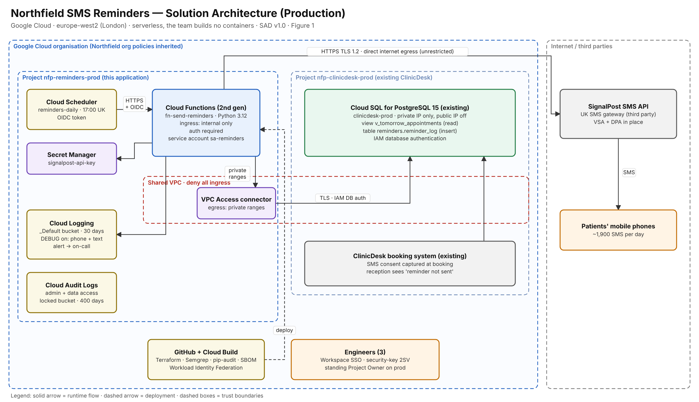

# Northfield SMS Reminders — Solution Architecture Document

| Document control | |
|---|---|
| Application | Northfield SMS Reminders (application ID NFP-APP-031) |
| Organisation | Northfield Physiotherapy Group Ltd (fictional) — Digital team |
| Document version | 1.0 — submitted for Architecture Review Board, 21 Nov 2026 |
| Author | Lead Engineer, Digital team |
| Reviewers | Information Security Officer; Data Protection Officer |
| Status | For ARB approval (target go-live: February 2027) |
| Classification of this document | Northfield Confidential |

---pagebreak---

## 1. Purpose and business context

Northfield Physiotherapy Group runs 14 clinics in the north of England. Missed appointments cost the group about 9% of clinic capacity. Northfield SMS Reminders sends every patient a text message the evening before their appointment with the clinic name, date and time.

The application is a single scheduled function on Google Cloud. It reads tomorrow's appointments from the existing ClinicDesk booking system database and sends each reminder through a third-party SMS gateway, SignalPost. It has **no user interface**, does **not expose an API** to users or other systems, and patients cannot reply to the messages (the sender ID is a no-reply name). It uses no message queue, event bus or file transfer, and no AI or machine-learning capability. The team deploys the function from source code; it does not build container images or run Kubernetes.

### 1.1 Business functions

1. Every day at 17:00 UK time, select all appointments for the next day where the patient has given SMS consent.
2. Send one SMS reminder per appointment through the SignalPost API.
3. Record the outcome of each send in the ClinicDesk database so that reception staff see "reminder not sent" on their existing ClinicDesk screens and can phone the patient.

### 1.2 Users

| User group | Approx. number | How they interact |
|---|---|---|
| Patients | ~1,900 reminders per day | Receive an SMS; no sign-in, no replies |
| Reception staff | 60 | See send failures inside ClinicDesk (existing system, out of scope) |
| Digital team engineers | 3 | Operate the Google Cloud project |

## 2. Architecture overview

Figure 1 shows the production architecture. The function runs in its own Google Cloud project, `nfp-reminders-prod`, in the europe-west2 (London) region. It reaches the existing ClinicDesk Cloud SQL database over private IP through a Serverless VPC Access connector on the group Shared VPC, and calls the SignalPost API over the internet.

## 3. Components and technology stack

| Component | Technology | Notes |
|---|---|---|
| Scheduler | Cloud Scheduler job `reminders-daily` | Calls the function with an OIDC token for service account `sa-scheduler` |
| Function | Cloud Functions (2nd gen), Python 3.12, `fn-send-reminders` | Ingress "internal only", authentication required; runs as service account `sa-reminders` |
| Database | Cloud SQL for PostgreSQL 15 `clinicdesk-prod` (existing, project `nfp-clinicdesk-prod`) | Read view `v_tomorrow_appointments`; write table `reminders.reminder_log` |
| Secrets | Secret Manager secret `signalpost-api-key` | SignalPost API key |
| Network | Serverless VPC Access connector on Shared VPC `vpc-shared-prod` | Egress setting "private ranges only" |
| Monitoring | Cloud Logging and Cloud Monitoring | Alerting to the on-call engineer |
| Source and CI/CD | GitHub, Cloud Build, Terraform | Workload Identity Federation from Cloud Build |
| SMS gateway | SignalPost SMS API (third-party SaaS) | UK-based SMS aggregator |

## 4. Data

### 4.1 Data handled and classification

The Data Protection Officer has classified the data as **Northfield Confidential** under the Northfield Information Classification Standard. The fact that a person has a physiotherapy appointment is health-related personal data under UK GDPR. No payment card data is stored, processed or transmitted; patients pay at the clinic through a separate card terminal. PCI DSS is not applicable.

| Data | Examples | Classification |
|---|---|---|
| Appointment details | Patient first name, clinic, date and time | Confidential (health-related personal data) |
| Contact data | Patient mobile number | Confidential (personal data) |
| Send log | Appointment ID, masked mobile number, send status | Confidential |

The SMS text never includes the treatment type, the clinician's specialty or the patient's surname.

### 4.2 Data stores and protection

- Cloud SQL and Secret Manager encrypt data at rest by default with Google-managed encryption keys. Customer-managed encryption keys (CMEK) are not used; the DPO accepted Google-managed keys for this application.
- The send log `reminders.reminder_log` stores only the last three digits of the mobile number.
- Send-log rows are deleted after 90 days by a scheduled database job. Function logs are kept for 30 days in Cloud Logging. SignalPost keeps message content for 12 months under its standard terms; a shorter retention has been requested but not agreed.
- All Google Cloud resources are in europe-west2 (London). SignalPost processes and stores data only in UK data centres.
- A Data Protection Impact Assessment (DPIA-2026-07) has been completed and approved by the DPO. Patients opt in to SMS reminders when they book, and the function only selects appointments with the consent flag set. Patients can withdraw consent at reception.
- The test project `nfp-reminders-test` uses a copy of last month's production appointments in which the mobile numbers are replaced with the engineers' test phones; patient first names and appointment details are real.

## 5. Data flows

1. Cloud Scheduler calls the function over HTTPS with a Google-signed OIDC token. The function's ingress setting is "internal only" and it requires authentication, so it cannot be called from the internet.
2. The function reads the SignalPost API key from Secret Manager using its service account.
3. The function connects to Cloud SQL over private IP through the VPC connector, with TLS and IAM database authentication, and reads `v_tomorrow_appointments`.
4. For each appointment, the function calls the SignalPost API over HTTPS (TLS 1.2 or higher) with the API key. This traffic leaves Google Cloud directly to the internet; only private-range traffic goes through the VPC connector.
5. The function inserts the outcome of each send into `reminders.reminder_log`.
6. The function writes its logs to Cloud Logging.

## 6. Identity, authentication and authorisation

### 6.1 Engineers

- The three engineers sign in to Google Cloud with their Google Workspace accounts. Workspace enforces 2-step verification with security keys.
- All three engineers hold the basic **Owner** role on the production project permanently. There is no just-in-time elevation or approval step for production access.
- Engineers are removed from Workspace by the HR leaver process. There is no periodic review of who holds roles on the Google Cloud projects.

### 6.2 Service identities

- `sa-reminders` is a dedicated service account with no user-managed keys. It holds only Cloud SQL Client, Secret Manager Secret Accessor on the one secret, and Logging Writer.
- In the database, the IAM database user for `sa-reminders` can only `SELECT` from `v_tomorrow_appointments` and `INSERT` into `reminders.reminder_log`.
- `sa-scheduler` can only invoke `fn-send-reminders`.

## 7. Business rules and reliability

- **Quiet hours:** the function never sends a message outside 09:00–20:00 UK time; reminders that miss the window are recorded as not sent.
- **Daily cap:** the function stops after 3,000 messages in one day and alerts the on-call engineer, to contain cost and limit the damage of a faulty query.
- Each SMS is sent with the appointment ID as an idempotency key, so a retried run never sends a patient two reminders.
- If SignalPost is unavailable, the function retries with exponential backoff for up to two hours. Messages still not sent are recorded as "not sent" so that reception can phone the patients, and the on-call engineer is alerted.
- Phone numbers are validated as UK mobile numbers in E.164 format before sending. The patient first name is inserted into the SMS template as it is stored in ClinicDesk, without checks on length or characters.

## 8. Hosting, deployment and network

### 8.1 Hosting

The application is fully serverless on Google Cloud. Google manages the function runtime and its operating system patches. The project sits in the Northfield Google Cloud organisation and inherits the group organisation policies (no public IP on Cloud SQL, no service account keys, domain-restricted sharing). Security Command Center is not enabled for the organisation.

### 8.2 Network

- Cloud SQL has a private IP only; its public IP is disabled.
- The Shared VPC firewall denies all ingress; Cloud SQL accepts connections only from the VPC connector's IP range.
- Outbound internet traffic from the function is not restricted. The function could reach any internet address; there is no egress firewall or allow-list for SignalPost.

### 8.3 Build and deployment

- All infrastructure (project, function, scheduler, secret, IAM bindings) is defined in Terraform. Cloud Build applies it from the `main` branch using Workload Identity Federation, with no stored credentials. A nightly `terraform plan` reports any drift to the team channel.
- GitHub branch protection requires one approving review. Every pull request runs Semgrep static analysis and `pip-audit`; High or Critical findings fail the build. A CycloneDX SBOM is stored with every release.
- The SignalPost API key is also set as a Cloud Build substitution variable so that the integration tests can send test messages; it is visible to anyone who can view the Cloud Build triggers.

## 9. Third-party integrations

| Third party | Purpose | Data shared | Assurance status |
|---|---|---|---|
| SignalPost | SMS delivery | Patient first name, mobile number, clinic, date and time | Vendor security assessment completed (VSA-2026-022); data processing agreement signed; UK-only processing |

## 10. Security controls

| Area | Control | Status |
|---|---|---|
| Function access | Ingress internal only; authentication required; only `sa-scheduler` can invoke | In place |
| Service authentication | Dedicated service account, no keys; IAM database authentication | In place |
| Encryption in transit | TLS 1.2+ to SignalPost and Cloud SQL | In place |
| Encryption at rest | Google default encryption; no CMEK | Partial |
| Secrets | Secret Manager, but the key is also in a Cloud Build substitution variable | Partial |
| Code security | Semgrep SAST and required review on every pull request | In place |
| Dependencies | pip-audit and CycloneDX SBOM | In place |
| Privileged access | Standing Owner role for three engineers; no just-in-time access | Not in place |
| Egress | Unrestricted outbound internet from the function | Not in place |
| Penetration test | Not planned; the function cannot be reached from the internet | Not in place |

## 11. Logging, monitoring, backup and recovery

### 11.1 Logging and monitoring

- The function logs each run to Cloud Logging (`_Default` bucket, 30 days). Logging is at DEBUG level in production, which writes the full mobile number and the full SMS text of every message to the logs.
- Cloud Audit Logs record admin activity and data access for Cloud SQL and Secret Manager. They are exported to a locked log bucket with 400-day retention.
- Cloud Monitoring alerts the on-call engineer if the function fails or if more than 10% of sends fail. Logs are not forwarded to a SIEM and there is no security alerting.

### 11.2 Incident handling

The runbook lets the on-call engineer pause the `reminders-daily` scheduler job to stop all sends immediately. The runbook does not cover what to do if messages reach the wrong patients (for example notifying the DPO or the affected patients).

### 11.3 Backup and disaster recovery

The ClinicDesk Cloud SQL instance has automated daily backups (7 days) and point-in-time recovery in europe-west2. The function and its configuration can be redeployed from Terraform in under an hour. A database restore has not been tested by the Digital team.

## 12. Open items

| ID | Item | Owner | Target |
|---|---|---|---|
| OI-1 | Set production logging to INFO and stop logging phone numbers and message text | Digital team | Before go-live |
| OI-2 | Remove the API key from Cloud Build substitutions; use a separate test key from Secret Manager | Digital team | Before go-live |
| OI-3 | Replace standing Owner with Privileged Access Manager just-in-time grants | Digital team | Q2 2027 |
| OI-4 | Agree 30-day message retention with SignalPost | DPO | Q1 2027 |
